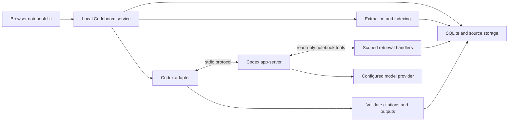

# Codeboom product and technical specification

Current user scope (2026-10-10): personal notes; dictation for questions about saved notes and written answers; local cited materials/exports and explicit web research. Video output, provider publishing, generated audio, YouTube and cloud/team features are deferred. This decision supersedes their earlier expansion priorities.

## Explicit web research acceptance criteria (2026-10-10)

A separate Find web sources action sends only the user's search query to live web search. Notebook text, question history and notebook instructions are excluded. Ordinary questions and Studio generation remain limited to selected saved sources with web search disabled. Search returns at most five candidate page titles and public HTTP(S) URLs; these candidates are discovery results, not cited evidence or an answer. The user reviews each address and explicitly imports chosen pages. Import uses the existing bounded public URL fetcher and saves original bytes, extracted text and import time as an immutable source revision. Only ready, selected snapshots can support answers and inspectable citations. A search or candidate does not automatically add a source.

Search uses a fresh isolated runtime with no notebook tools, filesystem tools, applications, MCP servers or OS network capability. Live search activity must be observed in the runtime protocol before candidates are accepted. Invalid/private addresses, fabricated response shapes and over-limit results fail closed. Search is bounded, cancellable and notebook scoped; deleted notebooks, cancellation and shutdown suppress late results. Closing the dialog cancels its outstanding search and stale responses cannot populate another notebook. Empty results and runtime failures are explicit and retryable. Automated protocol, service, API and browser checks plus a real synthetic live-search probe are required; human search relevance and provider availability remain release gates.

## Local infographic acceptance criteria (2026-10-10)

Infographics summarize selected saved evidence as up to six cited cards, a two-position comparison, or supported process steps. Every headline and body claim belongs to one card and retains exact citations, qualifiers, attribution, disagreements and inference labels. Steps require a separate cited factual statement supporting their order; without that evidence the output uses unordered cards. Comparisons give both positions equal space. No invented quantities, decorative factual labels, charts, remote assets or executable markup are accepted. Sparse evidence produces fewer cards; insufficient evidence produces notices only.

The local viewer offers keyboard-operable citations and complete readable text on desktop/mobile. Saved revisions, editing, history, promotion and purge follow existing notebook boundaries. PNG and inert SVG exports capture the displayed generated revision, with readable citations and full notices, plus exact quotes/spans/source revisions/derived ancestry in embedded provenance. Export refuses unavailable, authored or insufficient revisions, excessive content or unreadable overflow. Concurrency is bounded without a queue; cancellation/purge/shutdown withhold unfinished output. Automated checks and synthetic model/browser/rendering evidence do not replace named human semantic or representative-font release gates. Cloud/team, generated audio and YouTube remain deferred.

Status: Product specification v0.1; first prototype implemented, release gates remain subject to [verification](verification.md).  
Date: 2026-10-08

This document owns product requirements and acceptance criteria. The [implementation plan](plan.md) owns delivery sequence, and the [technical decision record](technical-decisions.md) owns implementation choices and their validation. Technical descriptions below provide the initial design context; maintain changes to those choices in the decision record, and update this spec when requirements change.

Codeboom is a research notebook that uses Codex as its agent harness. Users collect sources around a topic, ask questions grounded in those sources, and save useful answers as reusable research or study materials. Every substantive factual answer should let the user inspect its supporting evidence.

The implemented first prototype is a single-user local web app. This specification remains the release target; implementation evidence and remaining acceptance gates are recorded in [verification.md](verification.md). The technical decision record owns the selected stack and operational choices.

## 1. Product intent and reference behavior

The primary workflow is: collect → understand → investigate → synthesize → reuse.

A representative task: import two architecture proposals and meeting notes, ask where the proposals disagree, inspect the cited passages, then save a comparison brief. The same workflow should support a student turning course readings into a study guide.

The reference products provide two useful behaviors. Google's documentation distinguishes Gemini Notebook's source-only grounding from notebooks in Gemini Apps, which may also use web search and other tools. Codeboom adopts source-only answers for its first release; broader research is a separate later mode. [Google grounding documentation](https://support.google.com/gemininotebook/answer/17003757?hl=en)

Gemini Notebook also combines notebooks with sources, notes, and generated materials including reports, flashcards, quizzes, audio, and slides. Codeboom targets this overall workflow in stages, with inspectable evidence as the common foundation. [Google notebook documentation](https://support.google.com/gemininotebook/answer/16206563?hl=en)

Success means a user can understand and reuse a collection of documents without losing track of where the claims came from. Initial parity is behavioral, with original Codeboom branding and interface design.

## 2. Scope and release sequence

| Capability | First release | Later expansion |
| --- | --- | --- |
| Notebooks | Create, rename, archive, delete; notebook instructions | Tags, templates, cross-notebook discovery |
| Sources | Text PDFs, Markdown, TXT, pasted text, public HTML URLs | DOCX, slide decks, spreadsheets, images and OCR, audio transcripts, YouTube, Drive |
| Source controls | Select sources per conversation, inspect extracted text, refresh URL snapshots | Connector synchronization and discovery |
| Chat | Persistent conversations, source comparisons, citations, follow-up questions, cancellation | Explicit web-assisted research mode |
| Notes | Write notes, save an answer with citations, edit, export Markdown | Rich editing and publishing integrations |
| Studio | Cited summary, briefing document, study guide, FAQ | Flashcards, quizzes, mind maps, data tables |
| Media | No media generation in first release | Audio overview scripts and speech generation, slides, infographics, video |
| Sharing | Export local documents | Accounts, collaboration, permissions, hosted deployment — deferred by the user |

Audio overviews are a visible parity gap until the media phase. Codex can orchestrate a later transcript-to-audio workflow, but the design must add and validate a speech-generation capability; the harness alone is not an audio renderer.

First-release exclusions: Google account synchronization, automatic background research, arbitrary code execution requested through the notebook UI, public hosting, billing, mobile apps, and training a new model.

Current scope clarification, 2026-10-10: the user has deferred cloud hosting and team features, including account management, sharing/permissions, collaboration and connector synchronization. Keep these future designs documented but do not implement them in the current phase. Explicit selected-file Drive imports and local document exports remain local personal-notes features. Generated audio and YouTube are separately deferred; voice provides dictation for saved-note questions and answers remain written.

Provisional capacity targets: 50 sources per notebook, 25 MiB per uploaded file, and 500,000 extracted characters per source. These are Codeboom design targets to validate against a representative corpus, not claims about Codex or Google limits. Reject oversized inputs explicitly instead of silently truncating them. The current service separately admits at most two active source downloads/extractions and reports excess imports as retryable capacity failures; there is no background import backlog.

## 3. User experience

The notebook has three primary areas:

| Area | Contents and actions |
| --- | --- |
| Sources | Add files or URLs; inspect import status; select sources; open passages; refresh or remove a source |
| Conversation | Ask questions; see the current source selection; follow progress; stop a run; open citations; save an answer |
| Notes and Studio | Browse saved notes and generated documents; create a new artifact; edit or export it |

On smaller screens, these become tabs. Source selection and run status must remain visible. Citation links must work with keyboard navigation and return focus to the originating claim.

### First useful session

1. Create a notebook and give it a title.
2. Import two or more sources. Each shows queued, processing, ready, needs attention, or failed.
3. Inspect extraction warnings before asking a question. Failed sources are excluded; valid sources remain usable.
4. Ask a question with the selected sources displayed above the composer.
5. Receive a cited answer or an explicit statement that the selected evidence is insufficient.
6. Open a citation at its passage, save the answer as a note, and generate a briefing document.
7. Close and reopen the app; the notebook, conversation, notes, and citations remain available.

An empty notebook prompts for sources. A conversation with zero selected ready sources does not start a model run. With no useful evidence, an answer identifies what is missing and may suggest which document would help.

Notebook instructions can set audience, language, depth, and output style. They cannot override source boundaries or turn imported text into agent instructions.

### Notebook organization expansion

Tags are local notebook labels, normalized as NFC, trimmed and deduplicated without case distinctions. Allow up to ten labels of 48 Unicode characters each; label edits change metadata and update time without changing source selection, instruction versions or active research runs. Archived notebooks remain available through an explicit library filter.

Templates are versioned reusable recipes containing a name, description, instructions, tags and up to eight single-line starter questions of 1,000 Unicode characters each, with at most 100 personal recipes. Provide editable personal recipes and a small read-only built-in catalog. Users review the recipe when creating a notebook; creation copies a snapshot into an otherwise empty notebook with one empty conversation. A template carries no source files, citations, generated outputs, learner attempts, credential or provider settings. Later template edits/deletion cannot rewrite instantiated notebooks. Saving notebook settings as a template does not clone its evidence.

Cross-notebook discovery is an authenticated local read workflow with query/tag/archive filters and bounded pagination (200-character queries, 30 results by default, at most 50 per page). Search notebook names/tags, current nonremoved source titles/passages and available saved notes. Results show their notebook, type, text excerpt and locator where applicable. Exclude purged/removed/stale revisions and unavailable generated notes; retained authored edits remain discoverable. Opening a result switches to its owning notebook and opens the ordinary source/note viewer. It does not combine evidence manifests or change source selection; a result changed or purged before opening fails or displays the ordinary historical-revision state explicitly. No discovery query/results are sent to a model.

Acceptance covers Unicode/tag validation and no-op metadata edits; template CRUD/version snapshots/empty creation and read-only built-ins; local search/pagination/opening plus archive, source refresh/removal/purge and note-edit invalidation; legacy migration and stopped backup/restore; session/origin protection and unchanged cross-notebook tool rejection; keyboard focus and desktop/mobile containment. Human semantic release gates remain unchanged.

The local implementation and 123-test/browser evidence are recorded in verification. Named human release acceptance remains pending.

## 4. Source ingestion and provenance

Every imported source is a snapshot with a stable source ID and immutable revision IDs. Keep the original bytes, a content hash, extraction version, normalized text, and provenance. URL sources also keep the requested URL, final URL, title, and retrieval timestamp.

Import pipeline:

1. Validate format, size, and destination notebook.
2. Copy uploaded bytes or fetch the explicitly supplied public URL.
3. Extract text while preserving PDF page boundaries or document headings and paragraph locations.
4. Record extraction quality and warnings. Scanned or mixed PDF pages use the declared local OCR expansion; a nonblank page with no usable native/OCR text cannot be marked ready.
5. Split text into bounded, overlapping chunks; preserve offsets into the immutable normalized revision.
6. Index chunks and atomically mark the revision ready.

Source-type selection and per-query selection follow the reference workflow, where sources can be imported and individually selected for chat. Codeboom's supported formats and limits remain those in section 2. [Google source documentation](https://support.google.com/gemininotebook/answer/16215270?hl=en)

Use deterministic extraction for the first release. Do not use a model to silently rewrite source text. Detect duplicate content within a notebook and offer to reuse it; a refresh that changes content creates a new revision. Import retries use an idempotency key and do not create duplicate sources.

### Office and delimited spreadsheet import expansion

Status, 2026-10-10: uploaded DOCX/PPTX/XLSX/CSV/TSV is implemented in the local prototype with worker/API/browser/runtime evidence in verification. Representative authoring-tool files and human fidelity review remain pending. Web-link adapters remain HTML/PDF/plain text; legacy/macro/encrypted formats and media imports remain planned or unsupported. Image/PDF OCR has its separate policy below.

Add uploaded DOCX, PPTX, XLSX, CSV and TSV files through the same isolated extraction worker, original-byte retention, immutable revisions, scoped retrieval, duplicate offers, cancellation, failure and purge boundaries. Local development is authorized while release review remains pending. Legacy binary Office, encrypted packages and macro-enabled files are rejected explicitly; they are not converted into invented plain text.

DOCX preserves document-order paragraphs, headings and table rows with stable structural locators, plus related headers/footers, footnotes/endnotes and comments when present. Tracked insertions remain and tracked deletions are excluded with a warning. DOCX locators describe document structure rather than fabricated rendered page numbers. Unsupported embedded content and visual layout omissions are visible.

PPTX follows the presentation's declared slide order and preserves text, table rows and speaker notes with slide locators. Hidden slides are retained and labeled. Images, diagrams, charts without extracted data, animation and spatial reading-order limitations are disclosed; no external relationship is fetched.

XLSX preserves workbook/sheet order, sheet names, cell addresses, shared/inline strings, Boolean/error/numeric/date values, merged-cell annotations and hidden sheet/row/column labels. Preserve stored formulas and label any cached results as snapshots; never execute formulas, macros, external links or data connections. Missing cached results remain unavailable. Numbers retain stored values and available number-format metadata rather than assuming units, currency or dates. CSV/TSV preserves quoted delimiters, escaped quotes, multiline cells, row/column identities and Unicode. Empty cells remain explicitly empty; formula-looking text is stored as text.

ZIP members remain in memory and never become filesystem paths. Bound the archive entry count, XML part and cumulative decoded sizes, XML depth/element counts, worksheet/slide counts and final 500,000-character output. Reject malformed/truncated archives, decoded-part size/CRC inconsistencies, duplicate/unsafe member paths, unsafe relationship targets, invalid XML/entities and budget overflow without publishing partial evidence. The worker's existing 30-second deadline/cancellation and heap boundary still apply. Unsupported/omitted representations must produce visible warnings rather than silently implying complete fidelity.

| Acceptance scenario | Required evidence for expanded release acceptance |
| --- | --- |
| Fidelity and locators | Multi-paragraph/table/reference DOCX, out-of-filename-order slides with notes, multi-sheet shared/inline/formula/hidden/merged XLSX and quoted/multiline CSV/TSV; stable Unicode spans and original bytes across restart |
| Malformed and hostile input | Truncated/bomb/CRC/path/duplicate/encrypted/macro/entity/relationship/limit cases fail safely; no unrelated file read, network fetch or code/formula execution |
| Publication and lifecycle | Worker/API imports, failed retry and duplicate handling, historical citations, backup/restore and purge preserve current ownership and atomicity |
| User workflow | File picker advertises supported extensions; ready/warning/failed states, structural citation viewer and keyboard/mobile focus behavior work |
| Release qualification | Representative authoring-tool files and human fidelity review; bounded synthetic/parser proofs do not establish universal Office rendering fidelity |

### OCR import expansion

Status, 2026-10-10: the local English image/scanned/mixed-PDF adapter, warning UI and original snapshot downloads are implemented. The 137-test suite, two synthetic live model cases and bounded browser checks are recorded in verification. Representative scan/photo fidelity, other languages and human release qualification remain open.

Add uploaded PNG, JPEG and static WebP images and OCR for scanned or mixed PDFs. Use a pinned local English OCR engine and bundled language data; importing does not send images to a model or fetch language files. English is the initial supported OCR language, not automatic language detection. GIF, TIFF, animated images and handwriting are outside this adapter's declared coverage.

Preserve original bytes and immutable extracted text through the existing revision, exact Unicode citation, duplicate, scoped retrieval, backup and purge boundaries. Label OCR sections by image or PDF page. Provide a notebook/revision-scoped, integrity-checked attachment download of retained original bytes, including historical revisions; purged or foreign originals remain unavailable. Report engine/model/language, recognition confidence (an engine estimate, not proof of accuracy), and the need to check original numbers, names, punctuation and layout. Never silently correct recognized text with a model. On mixed PDF pages keep the native text layer separately from the full-page OCR rendering; disclose possible repeated text. Native text-only pages retain their existing page locators.

Check dimensions before decoding uploaded images. Bound each image/render to 12 million pixels and an 8,000-pixel side, PDF OCR to twenty pages and sixty million total rendered pixels, and final text to 500,000 Unicode characters. Retain the worker's 30-second deadline, cancellation and 256 MiB JavaScript heap limit; native canvas and WASM allocations are constrained by pixel/page budgets and are not covered by that heap limit; those budgets are not a measured hard cap on total resident memory. Confirmed white PDF pages can be skipped with explicit page warnings. Nonblank pages/images yielding no OCR text fail atomically instead of producing apparently complete partial evidence. Malformed, unsupported, oversized or timed-out inputs publish no revision. OCR/render diagnostics must not leak source text to routine logs.

| Acceptance scenario | Required evidence for expanded release acceptance |
| --- | --- |
| Recognition and provenance | Synthetic clean/noisy/EXIF-oriented image and scanned/mixed PDF fixtures retain page order, qualifications and numbers; original bytes, exact extracted-span citations and OCR warnings survive restart and backup |
| Failures and resource limits | Blank/nontext/invalid/animated/oversized images, malformed PDFs, page/pixel/output limits, cancellation and deadlines fail without partial publication, orphan work or runtime network access |
| User workflow | Picker advertises image extensions and English OCR; ready/warning/failed and retry/duplicate states, citation viewer, keyboard focus and mobile layout are verified |
| Release qualification | Human comparison against representative scans/photos and multilingual/layout/handwriting limitations remains required; synthetic recognition checks do not establish general OCR accuracy |

### Audio transcription import expansion

Status, 2026-10-10: local English audio uploads are enabled in the prototype, including fixed model setup, all advertised codec families, bounded AAC-LC M4A parsing, isolated process extraction, exact transcript citations and original downloads. Deterministic, actual offline/native lifecycle and desktop/mobile browser evidence are recorded in verification. Representative accents/noise, human listening/timestamp fidelity, sustained load and release acceptance remain pending.

Add uploaded WAV, MP3, M4A/AAC, FLAC and Ogg Vorbis/Opus recordings through a local English speech-recognition adapter. This is a separate source transcription step, not a grounded-answer or speech-generation request. An explicit setup command downloads a fixed, hash-verified Whisper tiny.en model revision. Imports use only installed local model/decoder assets, never send the recording to a provider, execute source instructions, or download models at runtime. Missing/corrupt assets produce an actionable failed import. Other languages, diarization, speaker identity and translation require separate future acceptance and are not inferred.

Retain original audio bytes, model/engine/language provenance, the complete normalized recognized text and estimated segment intervals in immutable revisions. Each transcript section has an audio/time locator; citations retain exact Unicode spans in the stored transcript, not fabricated offsets into the waveform. Label recognition/timestamp uncertainty and advise listening to the original before relying on names, numbers or commitments. Provide the existing scoped, integrity-checked original snapshot download with the proper audio extension. Never silently repair speech with a language model, invent speakers or treat confidence as verified accuracy. Unknown segment boundaries remain explicitly unknown; invalid/missing transcript structure fails instead of dropping text.

Accept at most 25 MiB and ten minutes per recording, one or two channels and 8–96 kHz decoded sampling rate. Apply an additional 24-million decoded channel-sample budget: compressed high-rate/stereo recordings may reach this limit before ten minutes. Decode incrementally with cumulative decoded-sample/channel limits; reject malformed/truncated/unsupported containers, inconsistent audio parameters, nonfinite samples, empty/silent inputs and duration overflow atomically. Downmix and resample locally to the recognition model's 16 kHz mono input with a declared policy. Audio runs in a disposable Node process with a bounded five-minute deadline and cancellation; other parsers retain their thirty-second Worker deadline. JavaScript heap remains 256 MiB; native ONNX/WASM work and threads need explicit controls and measured qualification, not an assumed total-RSS cap. Audio process exit must complete before resolving extraction or releasing its import slot, so native allocations cannot accumulate in the server. Use a fixed local entry point and bounded IPC, without a shell, source-controlled executable paths or nested inference/decoder subprocesses. Keep the existing two-import admission bound and no byte backlog. Failure, cancellation, retry, duplicate reuse, historical citations, backup and purge preserve the existing notebook ownership/publication boundaries.

| Acceptance scenario | Required evidence for expanded release acceptance |
| --- | --- |
| Recognition and timing | Synthetic or redistributable clear speech across advertised codecs, stereo/sample-rate conversion, multi-window recordings and separated pauses; numbers, negation/qualifiers, complete transcript and estimated time locators compared with the reference |
| Offline setup and failures | Fixed model hashes, atomic setup, missing/corrupt assets, malformed/truncated/container/duration/sample/channel limits, silence, cancellation/deadline and completed worker termination; no runtime audio transmission/model fetch |
| Publication and workflow | Actual worker/API/file-picker imports, visible transcription/warning/failed/retry/duplicate states, scoped original downloads, exact transcript citation viewer and desktop/mobile focus/layout, restart/backup/purge |
| Release qualification | Human listening comparison of representative accents/noise/multiple speakers, timestamp fidelity and CPU/memory/load qualification; synthetic results do not certify general transcription accuracy |

For URLs, support ordinary public HTML and direct PDFs. Do not execute page scripts, follow nested links, bypass authentication, or silently treat missing content as successfully imported.

### Google Drive import expansion

A user explicitly connects Google Drive through an external system browser, then selects a supported file or pastes its Drive/Docs/Sheets/Slides link. OAuth consent remains separate from notebook import; imported content must never grant connector access. Keep tokens out of source records, model context, URLs, diagnostics and backups. Do not inherit the coding agent's connected account into the product. Read/download selected files only; do not modify Drive, acknowledge abusive downloads, follow shortcuts, recurse folders or run background sync. Disconnect cancels owned retrieval and removes connector credentials without deleting retained notebook snapshots.

Support native Google Docs, Sheets and Slides through DOCX, XLSX and PPTX exports respectively, then the existing isolated parsers and their fidelity warnings. Support existing uploaded-file types through exact binary downloads. A saved notebook source contains immutable downloaded/exported bytes, extracted passages and safe provider provenance: file ID, native MIME type/name, provider version/modified time, retrieval time and chosen export format. Exported Office bytes are a rendition, not the original native Workspace file. Preserve cue/page/slide/sheet locators and warnings through the existing adapters. Exported formulas/layout/embedded media retain existing limitations.

Before retrieving content, require explicit download capability, a nontrashed supported file and valid version metadata. Download/export only through fixed Google API endpoints, with bounded metadata and streamed content, no redirects or bearer-token forwarding to arbitrary URLs. Use one deadline/cancellation signal across authorization, metadata, bytes and the consistency check. Check provider metadata again after retrieval and reject changed/version-mismatched content without publishing; this brackets retrieval and does not claim a provider-side transaction lock. Verify binary size and supplied checksum. Native exports have a conservative application limit of 10,000,000 bytes; uploaded-file downloads retain the 25 MiB input bound. Refuse shortcuts, folders, unsupported native types, restrictions, malformed metadata, empty content, scope/auth failures and overflow without partial evidence.

The macOS implementation loads only an explicitly configured Desktop client JSON outside notebook data (`CODEBOOM_GOOGLE_DESKTOP_CLIENT`) and uses a compiled Keychain helper (`npm run drive:setup`). An unconfigured connection is shown as unavailable and cannot be used to import. Shared-link resource keys may be used for the selected import but are omitted from persisted descriptors and provenance; a later key-dependent refresh or corrected retry requires entering the sharing link again. A new data directory does not inherit another directory’s connection.

Import, refresh, duplicates, explicit linked retries, selection isolation, immutable historical citations, original export/download, restart, backup and purge must use existing notebook boundaries. Refresh is explicit and retains prior versions; no automatic synchronization is implied. Acceptance needs connector/auth/ownership/cancellation tests, actual selected-file import through API/browser, exact retained-byte and provenance inspection, parser fidelity tests and named human review. Transport fixtures alone do not qualify an authenticated account connection or complete this expansion.

### Caption transcript files

Import uploaded UTF-8 SRT and WebVTT caption files as retained source snapshots, with declared cue times and locators. Preserve readable wording, negation, Unicode, explicit speaker labels and overlapping/repeated cues; do not infer speakers, deduplicate repeated speech, translate or correct the text. Flatten supported cue formatting without executing markup. WebVTT styles/regions and positioning are omitted with visible warnings; malformed timing, invalid encoding, unsupported cue markup, empty cues/files and resource overflow fail atomically. Admit at most 20,000 cues, 24 hours of declared timeline, 25 MiB original bytes and the existing 500,000-character normalized text bound. Caption timing and speaker labels are supplied metadata, not verified alignment or identity.

YouTube URL support is deferred at the user's request. Uploaded caption files do not retrieve video metadata or media. Representative caption fidelity and human release acceptance remain open.

Refresh changes the current revision without rewriting old citations. Removing a source excludes it from future runs but retains its historical revision for existing citations. A separate purge action removes retained source content and marks affected citations unavailable; it must state the consequences for saved outputs. Notebook deletion removes its local sources, indexes, outputs, and managed Codex sessions, subject to the retention boundary in section 10.

## 5. Grounding and citation contract

A run captures an immutable manifest of the selected source revision IDs. All retrieval and citations must resolve against that manifest.

Use SQLite full-text search as the initial retrieval baseline. Codex can reformulate a query and read neighboring passages through tools. For broad summaries, enumerate sections and gather evidence across every selected source rather than treating a few search hits as full coverage. Record omitted sections and label partial coverage. Introduce embeddings or reranking only if retrieval evaluations demonstrate the need.

Each citation records:

- Source ID, immutable revision ID, and chunk or passage ID.
- Exact quoted evidence and character offsets in the normalized revision.
- A display locator, such as PDF page or heading and paragraph.
- The claim or output block it supports.

Numeric labels such as [1] are presentation only. The application resolves them from stored citation records; the model never invents a source URL or file path for the viewer.

Before an answer becomes a completed output, the backend validates that every citation belongs to the run, the passage exists, offsets are valid, and the quote matches stored text. It rejects invalid evidence references. One bounded repair attempt may correct references; otherwise show a failure with the draft available separately and without verified citation styling.

Citation integrity does not prove that a passage supports a claim. Prompting and evaluation must separately check semantic support, correct attribution, and omitted qualifications. The UI must not describe structural citation checks as a truth guarantee.

Answers must distinguish source statements, synthesis or inference, disagreements between sources, and insufficient evidence. Every substantive factual claim needs supporting citations; inferences identify their supporting premises. Imported text is untrusted data even if it looks like a system prompt.

### Selection changes and conversation history

Persist the visible conversation independently of Codex's context. Reuse a Codex thread only while its source manifest, notebook instructions, and grounding mode remain compatible.

When the selected sources, current revisions, or instructions change, begin a fresh Codex context. Keep the old conversation visible, but do not replay previous generated answers or source excerpts into the new context. The next question must be self-contained or the app asks for clarification. This prevents excluded evidence from persisting through conversation history or compaction.

If a source is removed or purged during a run, cancel that run and reject late results. For a refresh or selection change during a run, also cancel and let the user restart with the new manifest. Previously completed outputs retain their historical manifest and display when they use an older revision.

Notes are not evidence by default. A user can explicitly promote a note to a new source revision. Generated notes retain their derivation links and a generated-content label; they cannot count as independent corroboration of their originating documents.

## 6. Codex harness architecture

Codex owns the model/tool loop, thread execution, progress events, and cancellation. Codeboom owns source ingestion, retrieval indexes, product state, citation validation, and saving outputs. The application does not implement a competing general-purpose agent loop.

The proposed integration is a local backend spawning `codex app-server` over stdio. OpenAI documents app-server for custom clients that need authentication, conversation history, approvals, and streamed events; it documents the Codex SDK for programmatic automation as well. App-server and its experimental surfaces need a pinned compatibility test before this design advances beyond a prototype. [Codex app-server](https://learn.chatgpt.com/docs/app-server), [Codex SDK](https://learn.chatgpt.com/docs/codex-sdk)

The browser talks only to the Codeboom service. It never connects to app-server directly or receives provider credentials.

### Integration lifecycle

1. Start the pinned Codex executable in an app-managed environment and complete `initialize` / `initialized`.
2. Read account state and available models. Require user setup when authentication is missing; keep model choice configurable.
3. Start or resume a compatible thread. Persist notebook, conversation, manifest, and Codex thread associations.
4. Call `turn/start` with the question, notebook instructions, source manifest, and structured output schema.
5. Relay progress and collect tool events. Tool handlers derive their authority from the server-held run context.
6. On `turn/completed`, validate output, then commit the answer or artifact atomically.
7. On stop, request `turn/interrupt`; discard late completion after the run is cancelled.

These lifecycle operations and per-turn `outputSchema` are documented app-server capabilities. Generate protocol types from the selected executable rather than hand-maintaining an approximate protocol. [App-server lifecycle and schema](https://learn.chatgpt.com/docs/app-server)

The local CLI observed while drafting is `codex-cli 0.160.0`. This is an observation, not a proven compatibility baseline. Milestone 1 must select and pin the version, generate its schema, and verify the required fields against that version. Do not hardcode a model name based on documentation examples.

### Notebook tools

The proposed prototype uses app-server dynamic tools behind the adapter. Dynamic tool registration and `item/tool/call` are explicitly experimental and require capability opt-in. If this interface is unsuitable, retain the same application contracts behind a scoped MCP server; that alternative needs its own integration check. [Dynamic tool documentation](https://learn.chatgpt.com/docs/app-server#dynamic-tool-calls-experimental)

| Tool | Input | Output |
| --- | --- | --- |
| `notebook_list_sources` | No model-supplied notebook ID | Selected revisions, titles, extraction warnings, section inventory |
| `notebook_search` | Query, bounded result limit | Ranked passages with stable IDs and display locators |
| `notebook_read_passage` | Passage ID, bounded surrounding context | Exact text and immutable revision metadata |
| `notebook_list_sections` | Selected revision ID, cursor | Ordered sections and pagination for comprehensive summaries |

All IDs are checked against the server-held manifest. A model-supplied ID is a lookup request, never permission. The tools are read-only. The backend saves generated outputs after validation; the model does not mutate SQLite or write notebook files directly.

Proposed internal adapter methods are `startSession`, `runTurn`, `cancelTurn`, and `disposeSession`. These are Codeboom abstractions, not names of Codex SDK methods.

### Capability boundary

Reading imported documents must not give the agent access to the user's development repository, home directory, global plugins, or arbitrary network destinations. Launch with dedicated configuration, restricted readable roots, no workspace writes, and no shell or external tools available beyond the approved notebook tools where the runtime permits.

A read-only preset alone is insufficient because it may permit broad reads. Verify effective permissions and loaded instructions; fail startup if the required isolation cannot be enforced on the supported platform. Sandbox settings, tool availability, and the external tool handlers are separate controls. Do not use prompt instructions as the only enforcement mechanism.

The initial support target is the user's macOS local environment. Broader OS support waits for equivalent isolation tests. All model-provider traffic remains necessary for inference; source-only mode disables research browsing and unrelated agent network access.

## 7. Storage and application interfaces

Proposed stack: TypeScript for the local service and Codex adapter, React for the browser UI, and SQLite with full-text search for persistence and retrieval. Choose exact framework and parser versions at implementation time.

Store product data outside tracked source code under a configurable application data directory. Local development may use ignored `.codeboom/`. SQLite owns canonical metadata; immutable blobs hold originals and extracted text. Codex thread history is execution state, not the only copy of the user's notebook.

| Entity | Essential fields |
| --- | --- |
| Notebook | ID, title, instructions and version, timestamps, archive state |
| Source | ID, notebook ID, kind, title, origin, current revision, removal state |
| SourceRevision | ID, source ID, hash, blob path, extraction version, quality, created time |
| Passage | ID, revision ID, section/page locator, text offsets, indexed text |
| Conversation | ID, notebook ID, visible messages, current execution context |
| Run | ID, conversation ID, manifest, instruction version, model/runtime version, status, usage |
| Message | ID, conversation ID, role, blocks, citations, run ID, timestamps |
| Artifact | ID, notebook ID, kind, revisions, content, citations, originating run, edit state |
| Job | ID, type, idempotency key, status, attempt count, error, timestamps |

Enforce notebook ownership through database relationships and every application query, even in the single-user version. Use atomic transactions for final outputs and keep file operations recoverable across crashes.

The local API supports notebook CRUD, source import/refresh/removal, conversations, run start/cancel, artifact generation/edit/export, and citation resolution. Stream progress to the browser using server-sent events with application-assigned sequence numbers and replay from persisted run state. Do not assume Codex notifications are an exactly-once durable event log.

A structured answer has `status` (answered or insufficient_evidence), typed content blocks, citation records, and coverage warnings. Artifact outputs add a kind and structured sections. Persist the output schema version. The UI renders supported blocks safely instead of executing arbitrary returned HTML.

## 8. Notes and generated artifacts

Saving an answer creates an editable note while preserving citations and its source manifest. User edits create a new artifact revision. Mark edited passages as user-authored; do not imply their original citations still support new text without revalidation.

Studio generation shares the same source selection, retrieval, and citation contract as chat:

- Summary: key points and limitations across the selected sources.
- Briefing document: context, findings, disagreements, and open questions.
- Study guide: concepts, explanations, examples, and revision questions.
- FAQ: questions and supported answers.

Generation is explicit and cancellable. A job shows queued, running, validating, completed, failed, or cancelled. Retrying creates a linked attempt and cannot silently overwrite a completed artifact.

Markdown exports include citation footnotes with source title, revision, locator, and available origin URL. If the source is local, say so; do not export a citation link that pretends a local-only source is publicly accessible.

Later flashcards and quizzes include evidence for answers. Later audio overviews first produce a cited script, then synthesize speech through a separately selected provider. Media outputs retain the script and source provenance even when the audio itself cannot display citations.

### Rich note editing expansion

Provide a local visual editor with paragraphs, headings (levels 1–3), bold/italic/underline/strikethrough, inline/code blocks, bullet/numbered nested lists, quotes, hard breaks, rules and explicit HTTP(S) links. Support selection formatting, undo/redo, keyboard operation, plain-text paste and narrow-screen containment. Store a versioned structured document, never arbitrary executable HTML, remote images or embeds. Bound documents to 100,000 Unicode text characters, 5,000 nodes, depth twelve and one MiB serialized JSON; validation failures leave the saved revision untouched.

Protect unsaved personal-note drafts. Close or Escape asks whether to keep editing or discard when the title/document has changed. Keeping the draft retains its text and returns focus; explicit discard closes the editor. Refuse closing while an explicit save is pending, then retain the draft if saving fails. Warn through the browser's ordinary leave-page prompt while changed text or a save is pending. Undo/reverting to the original title/document removes the unsaved-change warning. Local recovery drafts follow the criteria below; a successful explicit Save remains the publication boundary.

Opening a generated output in the editor preserves its text, section/item/map/table labels, inference/gap/coverage qualifications and exact citation attachments. Edits become user-authored and display that attached references have not been semantically revalidated against the edited text. Citations are inline removable/reorderable atoms. Users may attach an exact quote from a stored passage in their notebook; malformed offsets/quotes and foreign IDs are refused. Retained historical references still open their immutable source revision. Existing attached references whose source was purged remain explicitly unavailable; they cannot be forged into new notes or imply current support.

Every save creates an immutable revision, with stale-base refusal when another save changed the current note. Show revision history, inspect generated originals with their typed content/provenance and restore a historical revision as a new authored rich revision without overwriting any history or carrying a quiz scoring key forward. Keep legacy plain text/generated notes readable. Authored rich edits survive source purge; their reference buttons resolve as unavailable. Generated originals and derived source copies follow existing purge rules.

Rich notes participate in local discovery, restart, stopped backup/restore, exact-revision source promotion and Markdown export. Export preserves formatting, explicitly labeled authored/reference status and immutable citation footnotes, escaping authored markup so literal HTML cannot execute in a Markdown renderer. Promotion uses readable text and an authored-reference qualification without creating independent corroboration. No editor/history operation starts a model run.

Acceptance requires formatting and nested structures, undo/redo and selection handling, legacy/generated conversion across every artifact kind without losing citations/qualifiers, strict shape/link/citation/budget validation, scoped API/history/stale-save/restore behavior, immutable original and promotion ancestry, purge/FTS/restart/backup behavior, and keyboard/desktop/mobile checks. Publishing integrations remain a separate planned extension; human semantic and release gates remain unchanged.

Status, 2026-10-10: the local visual editor, strict validation, history/restoration and export/search/lifecycle integration are implemented. The 131-test suite and bounded desktop/mobile/browser evidence are recorded in verification. Publishing, broader assistive-technology qualification and human release gates remain open.

### Recoverable note drafts

Status, 2026-10-12: PN1 is implemented following the user's request to proceed. See the [verification record](verification.md#recoverable-note-drafts-2026-10-12).

Automatically retain unsaved note titles and editor content locally and offer recovery after reload or a browser crash. Draft persistence must remain separate from published note revisions: explicit Save publishes a revision, and explicit Discard removes the recoverable draft. Recovery must preserve formatting and attached references and must not silently overwrite a saved revision changed in another window. Verify recovery for new and existing notes, successful save/discard cleanup, failed saves and stale-base conflicts. Voice recordings and transient question transcripts remain outside note draft persistence.

Persist after a 400 ms editing pause and report pending, saved or failed recovery status. Recovery guarantees the last acknowledged local save, not unacknowledged keystrokes during a crash or outage. Show recoverable draft titles in Notes & Studio and offer recovery, discard or a separate draft when entering New/Edit. Preserve the original base revision on recovery. Concurrent edits must not silently overwrite another window's draft; retain separate recovery copies when they diverge. Failed publication retains recovery; successful publication clears only its submitted draft version atomically. Undo to the opening saved baseline removes that editor's draft.

Keep up to 50 active recovery drafts per notebook, with existing rich-note document limits and titles of up to 200 Unicode characters (including empty drafts). Drafts are notebook-scoped, included in stopped backup/restore and deleted with the notebook, but excluded from discovery, exports, source selection and model requests. Treat retained draft text as authored content: source purge leaves its attached references visibly unavailable, and new missing or foreign references remain invalid.

### Individual note deletion and Trash

Status, 2026-10-13: PN2 is implemented following the user's request. See the [verification record](verification.md#individual-note-trash-and-deletion-2026-10-13).

Open a saved note or Studio material and choose **Move to Trash**. Hide it and its recovery drafts from ordinary note lists and library discovery. Retain its exact saved revisions, references, quiz attempts, drafts and already-published promoted/conversation snapshots. Existing pinned conversations and citations remain usable. Trash has no automatic expiry. Restore returns the same saved revision and history without publishing a new revision or invoking the model. Block editing, export, historical-revision restoration, new note conversations and new promotions while the note is trashed; history remains readable. Cancel pending promotions and require an explicit retry after restoration.

The notebook's **Trash** dialog lists titles, trash dates and retained revision/draft counts, with **Restore** and **Delete permanently…** controls. The permanent-delete confirmation explains removal of all note revisions, recovery drafts, quiz attempts, generated speech assets and pinned conversations with their questions/answers. Purge all snapshots promoted from the note, including snapshots used by pinned conversations, and follow the existing recursive source-purge policy: dependent generated outputs become unavailable, and retained authored notes/drafts mark their references unavailable. Stop active notebook answers and withhold late publication/exports. Original independent imports and the original chat/generation output where the note was saved remain. Existing backup/export copies retain their contents; permanent deletion cannot revoke them.

Permanent deletion is allowed only from Trash and requires explicit confirmation. Notebook ownership, the displayed saved revision and an incrementing Trash lifecycle version protect against stale requests from other windows; restore/delete actions reject a note restored or re-trashed since the dialog loaded. A content-free deletion receipt permits an identical deletion retry after a lost response. Remove the note and its history only after managed blob cleanup succeeds; partial cleanup leaves the note in Trash with a visible error and an explicit retry path. Minimal purged-source tombstones retain unavailable provenance rather than inventing an originating revision.

Acceptance covers move/restore/delete and dependency behavior, exact rich formatting/references/history, hidden drafts and search exclusion, stale and foreign IDs, session/origin checks, interrupted promotion, late-result refusal, restart and current/legacy stopped backup/restore. Browser checks cover keyboard/focus return and desktop/mobile containment. Named human semantic, full assistive-technology and broader release gates remain separate.

### Portable formatted export

Add an explicit HTML download for saved notes and generated materials alongside Markdown. Export the exact displayed immutable revision, including its historical title, authored/generated status and revision timestamp/identity. Legacy revisions whose title was not retained must say so. Preserve rich formatting and line breaks, document sections, study answers and labeled distractors, map relationships, table missing values, inference/gap/coverage qualifications and readable evidence footnotes with exact quotes, source revision, locator, span and available origin. Exclude learner attempts and unsaved note drafts. Purged generated revisions are unavailable; retained authored notes label missing references without exporting the purged quotation as evidence.

The document opens offline and supports the browser's ordinary print flow. Use semantic headings/lists/tables, keyboard-accessible footnote links, responsive containment and print styles. Escape every authored/generated/source text value, allow only explicit validated HTTP(S) links, and include no scripts, embeds, remote assets or automatic network requests. Download only through the existing authenticated, notebook/revision-scoped API, without model calls, new storage/revisions or external publication. Bound output size and fail rather than truncate. Acceptance requires content fidelity across all existing kinds, hostile markup/link/provenance checks, exact current/historical/foreign/purge behavior through HTTP, and actual desktop/mobile rendering/download checks. Provider-specific publishing integrations remain planned separately; portable files do not establish external publication.

Status, 2026-10-10: implemented with four export groups, authenticated current/history/purge HTTP checks and actual browser download/desktop/mobile/keyboard observations. The 207-test suite passes. Print styles are present; native print-dialog/pagination, wider assistive-technology use and original human release gates remain unverified.

### Study expansion: flashcards and quizzes

Status, 2026-10-10: implemented in the working local prototype with deterministic/runtime/browser evidence recorded in verification. Named human semantic review remains pending. This is the first expansion chosen while the user's optional priority clarification is unanswered. First-release and expansion acceptance gates remain unchanged.

A user selects ready sources, creates a flashcard set or quiz in Studio, follows generation progress, and opens the saved material. Generation uses the same selected-revision manifest, notebook instructions, scoped tools, context budget, cancellation, explicit retry and atomic publication as existing documents. The requested item count defaults to 10 and can be set from 5 to 20. If evidence supports fewer distinct items, return fewer with an explicit coverage/count warning; do not invent questions to fill the request. No useful evidence produces an insufficient-evidence result rather than an empty playable set.

Each flashcard has a stable item ID, a question/front, an answer/back and cited evidence for every substantive claim, including premises in the front. Reveal hides only the answer presentation; citations remain inspectable once revealed. Previous/next/reveal controls work by keyboard, expose their state and position, and return focus after citation inspection. The set records its original source and instruction snapshots and remains readable after restart.

The initial quiz uses single-choice questions with three or four distinct options, exactly one correct option and a cited explanation. Options are clearly labeled candidate answers: distractors are not displayed as supported source statements. Question premises, the correct answer and the explanation require supporting evidence. Correctness is evaluated locally against the immutable stored answer key; choosing an option or submitting an attempt starts no model run. Feedback and the explanation appear after submission. Score means matching this generated answer key, not independent certification that the key is true. Conflicting evidence must be attributed in the question or omitted with a warning rather than yielding ambiguous correct options.

Quiz attempts belong to a notebook and an exact artifact revision. Persist chosen options, submission state and score so reopening does not lose an attempt or submit it twice. A new attempt is explicit and leaves earlier attempts unchanged. Learner choices never enter model history, source evidence or routine diagnostics. Purge makes affected generated questions/keys/explanations unavailable and removes their attempt records; notebook deletion removes all its study material and attempts. A user-authored edited revision does not inherit a generated answer key or interactive scoring; the original generated revision retains its provenance.

Markdown export includes questions/fronts, correct answers/backs, explanations, coverage warnings and readable citation footnotes. A quiz export labels distractors explicitly and excludes learner attempts. Promotion of generated study material to a derived source uses only questions and supported correct answers/explanations, excluding distractors and learner choices; it pins the exact generated revision and retains the existing generated-origin qualification.

| Acceptance scenario | Required evidence for expanded release acceptance |
| --- | --- |
| Structured material | Reject missing/duplicate item IDs, unsupported claims, invalid counts, duplicate options and absent/multiple correct options before publication; exactly matching immutable citation spans for every accepted reference |
| Evidence sufficiency | Supported, sparse, unanswerable and conflicting synthetic fixtures for both kinds; visible count/source/section omissions; no fabricated padding |
| Semantic quality | Named human review of questions, answers, explanations and distractor ambiguity; at least 95% supported factual claims and every reviewed quiz item has one unambiguous correct answer |
| Study interaction | Keyboard reveal/navigation/selection/submission, citation focus return, labeled state/score and no horizontal overflow at 390px; local scoring causes no provider request |
| Persistence and ownership | Restart and backup restore preserve exact generated revisions and quiz attempts; foreign notebook/item/revision IDs and repeated submissions are rejected or idempotent |
| Lifecycle and provenance | Selection/instruction mutation, cancellation, retry, edit, export, promotion and purge preserve the existing boundaries; late runs cannot publish material and attempts cannot attach to another revision |

Mind maps and data tables have the separate expansion contract below; other inputs, media, research and collaboration remain planned. This expansion does not replace those requirements or authorize release before the first-release gate passes.

### Structured expansion: mind maps and data tables

Status, 2026-10-10: implemented in the local prototype with structural, runtime and browser evidence. Named human semantic review and expanded release acceptance remain pending.

Mind maps and data tables use the existing selected-revision generation, exact citations, bounded repair, coverage, cancellation, retry, storage, edit and purge paths. A mind map is a rooted hierarchy with stable node IDs, parent links, readable labels, named relationships and cited details. Substantive labels and relationships need evidence; a hierarchy must not present an unsupported causal relationship as fact. Render a visual connected map and a keyboard-accessible outline with collapse/expand and citations. The local prototype bounds a map to 40 nodes and six levels; any evidence or size omissions must be disclosed.

A data table has stable row/column IDs, readable labels and an ordered cell for every column in each row. Cells refer to cited fact/inference blocks; missing evidence is displayed as “Not stated”, never an invented zero or negative. Substantive row/column labels require citations. Preserve source attribution, units, proposed/conditional qualifiers and conflicting values; computed comparisons must be explicitly labeled inference with evidence. Bounds are eight columns and twenty rows, with visible omissions when those limits or evidence budgets prevent a complete result.

Both outputs preserve all labels, relationships/cells, evidence gaps and exact provenance in Markdown export and derived-source promotion. Exports use nested map relationships or a readable Markdown table, with label and cell references. Edited revisions become authored notes and retain their immutable original. Insufficient evidence has no populated map/table and a clear notice. No new provider or tool permissions are required.

| Acceptance scenario | Required evidence for expanded release acceptance |
| --- | --- |
| Structural integrity | Reject duplicate IDs, cycles/orphan map nodes/multiple roots/depth overflow, missing/duplicate/unknown table cells and unassigned/duplicate supported blocks before publication |
| Grounding and gaps | Exact selected-manifest citations for labels/relationships/details/cells; supported, sparse, conflicting and insufficient-evidence cases; explicit missing cells and coverage omissions |
| Semantic quality | Named human review of labels, relationships, units, attribution, qualifiers and every factual/inferred cell/detail; at least 95% supported claims and no misleading missing-value substitution |
| Interaction | Connected visual map plus keyboard outline/collapse/citation focus return; semantic table headers and readable narrow layout; no page overflow at 390px |
| Persistence and provenance | Restart/backup, authored edits, retry/cancellation/mutation guards, original revision inspection, typed exports/promotion and purge retain existing boundaries |

### Slide deck expansion

Prototype checkpoint, 2026-10-10: contract 7 generation, viewer, revision-pinned editable PowerPoint and lifecycle integration are implemented. [Lifecycle evidence](../evals/results/2026-10-10-slides-lifecycle-v7.json) records 252-test regression, controlled actual-encoder purge/cancellation/admission/shutdown checks and live multislide desktop/mobile navigation. [Native evidence](../evals/results/2026-10-10-slides-native-v7.json) covers three synthetic decks/seven pages in bundled LibreOfficeDev. Four prior actual model cases and promotion evidence remain preserved. Microsoft PowerPoint/Keynote/stable LibreOffice, representative files/fonts, live assistive technology and human semantic/coverage release gates remain unproven.

A user chooses **Slides** in Studio to turn the selected evidence into a concise cited deck. Generation uses the existing pinned source/instruction manifest, scoped tools, context budget, validation/one repair, cancellation, linked retry and immutable artifact revisions. Return at most eight slides; fewer are appropriate for sparse evidence, with explicit coverage/size warnings instead of filler. Insufficient evidence produces an ordinary notice with no populated slides.

Every slide has a stable unique ID, one headline block, one to four body blocks and zero to two speaker-note blocks. Headline and body are single-line concise fact/inference blocks with exact citations, not uncited presentation copy. Bound headlines to 70 Unicode characters, body blocks to 160 and speaker-note blocks to 400; each has at most four references. All supported blocks are assigned exactly once, including speaker notes. Notices remain separate evidence limitations. Preserve attribution, uncertainty, units and source conflicts; visual polish cannot imply semantic verification.

Provide a local slide viewer with previous/next controls, a labeled slide position, keyboard navigation, expandable cited speaker notes and a complete accessible outline. Citation inspection uses the ordinary immutable passage viewer and returns focus. Desktop and 390px layouts must contain long words and Unicode without hiding text. Markdown/portable HTML exports and promotion preserve the slide sequence, headline/body/notes, warnings and citations; edited revisions become authored notes without inheriting generated-slide validation.

PowerPoint export downloads a self-contained `.pptx` from the exact displayed generated revision. Use editable native text and simple shapes with a consistent 16:9 layout. Show numbered references on each claim and retain full source title/revision/locator/quote and derived-evidence qualifications in speaker notes. Include coverage limitations and revision/authorship provenance. No fetched/embedded images, fonts, scripts, macros, arbitrary paths, media, external relationships or publishing actions are introduced. Bound export input/output, reject overflow or missing/purged evidence instead of truncating, and recheck availability after asynchronous assembly before sending. Export makes no model call or storage revision and does not publish to a provider.

| Acceptance scenario | Required evidence |
| --- | --- |
| Structure/grounding | Reject duplicate IDs, wrong/dangling/duplicate block assignments, mixed artifact structures, overflow and uncited/invalid spans; supported, sparse/conflicting and insufficient-evidence generation |
| Lifecycle | Shared cancellation/mutation/retry, immutable history, authored edits, restart/backup/promotion and purge; no late export after evidence purge |
| Interaction | Keyboard slide navigation, full outline/notes/references, ordinary citation focus return, desktop/mobile containment and no provider calls from browsing |
| PowerPoint | Exact headline/body/notes/reference/provenance text in a bounded valid archive with no external relationships; retained PPTX reparses through the Office adapter; real API current/history/foreign/purge download checks |
| Release qualification | Actual model deck and browser render plus named human semantic/coverage review; representative PowerPoint/Keynote/LibreOffice opening/layout and assistive-technology checks. Library/ZIP/HTML checks alone do not certify every Office viewer |

## 9. Reliability and resource limits

Allow one active run per conversation and bounded local generation admission. The prototype admits at most two active runs and explicitly rejects excess requests for later retry; it does not hold a background backlog. Default prototype budgets: 20 retrieval calls, 120 seconds per chat turn, and 5 minutes per artifact job. Make these configurable and record when a budget is reached; these are product targets pending measurement.

Bound tool response size and total evidence context using the selected model's capacity. A budget cutoff produces a partial-coverage result or explicit failure. Never present a truncated output as a complete notebook analysis.

Record latency, source count, tool calls, runtime/model version, and usage when available. Display unavailable usage as unknown. Do not invent a monetary estimate for subscription-backed execution.

Handle authentication expiry, provider rate limits, parser failure, app-server exit, and malformed output as distinct recoverable errors. A lost connection does not automatically justify rerunning a paid generation. Reconcile stored run/thread state first; if the outcome remains unknown, mark it interrupted and offer retry.

Partial streaming output is provisional until validation completes. Reopening the browser reattaches to the existing local run rather than starting a duplicate.

## 10. Privacy and trust boundaries

Local storage does not mean local inference: the configured model provider receives prompts and selected context. Explain this during setup. Use supported Codex authentication and avoid copying credential files into notebook data or the repository.

Serve the local API on loopback, require a session token, and validate request origins. URL ingestion rejects local, private, link-local, and cloud-metadata destinations, including after DNS resolution and redirects. Apply byte and time limits. Render extracted documents and Markdown without active scripts.

Do not persist raw source text in routine diagnostics. Application data, provider-side data, Codex-managed transcripts, and user exports have different retention boundaries. Purging a source must clear managed local copies and invalidate or delete relevant execution contexts; it cannot erase previous provider requests or exported files. Expose any failed local cleanup instead of claiming complete deletion.

The first release must pass a malicious-document test in which source text attempts to change instructions, read unrelated files, or send data to a URL. The result must preserve evidence boundaries and must not execute those requests.

## 11. Acceptance and evaluation

Create a small fixture corpus with text PDFs, Markdown, a public-page snapshot, contradictory documents, a scanned PDF with no usable recognized text, and a document containing prompt injection. Use synthetic or redistributable content.

| Scenario | Required result |
| --- | --- |
| First session | Import two sources, ask a question, inspect citations, save and reopen a note |
| Citation integrity | 100% of completed output references resolve to selected immutable revisions with exact quote matches |
| Insufficient evidence | At least 9 of 10 deliberately unanswerable fixture questions correctly abstain |
| Claim support | At least 95% of factual claims in a fixed 30-question fixture set are supported by cited passages on human review |
| Source conflict | Present both conflicting statements with their respective evidence |
| Isolation | Cross-notebook IDs and excluded revisions are rejected; unrelated files and network endpoints remain inaccessible |
| Selection change | Start a fresh context; no excluded source text appears in retrieval or replayed model context |
| Refresh and removal | Old completed citations retain their version; active affected runs cancel; purged evidence shows unavailable |
| Broad summary | Cover every selected source or visibly identify omitted sources/sections |
| Failure and retry | Recover from parser/runtime failure without duplicate sources, runs, or artifacts |
| Cancellation | UI acknowledges stop immediately and no later output is committed from that run |
| Export | Exported artifact includes usable human-readable provenance |
| Persistence | Restart the service and recover notebooks, notes, history, and citation locations |

These are release gates; consult [verification.md](verification.md) for achieved metrics and open checks. Structural validation is deterministic; semantic support needs separately labeled human review. Keep the evaluation corpus and rubric versioned so model or harness upgrades can be compared.

Measure ingestion time, time to first progress, end-to-end answer latency, and cancellation completion during the first prototype. Set performance commitments after a baseline exists; network model latency is not under complete application control.

## 12. Implementation milestones

1. **Harness integration proof.** Pin Codex, generate protocol types, verify authentication and model discovery, enforce isolation, register read tools, stream and cancel a turn, and obtain schema-valid output. Answer one question over two text fixtures with working citations. Exit gate: the adapter and tool boundaries work on the target machine.
2. **Notebook and ingestion foundation.** Implement SQLite migrations, source revisions, text/PDF/URL extraction, full-text search, source viewer, and import errors. Exit gate: deterministic provenance survives a restart.
3. **Grounded conversation.** Connect the three-area UI, source selection, thread mapping, validation, streaming, and insufficient-evidence behavior. Exit gate: citation, conflict, isolation, and selection-change tests pass.
4. **Reusable outputs.** Add notes, the four initial Studio formats, revisions, and Markdown export. Exit gate: an end-to-end research session can be completed and exported.
5. **First-release hardening.** Add recovery, budgets, deletion, accessibility checks, and the evaluation corpus. Exit gate: all first-release acceptance criteria pass.
6. **Expanded parity.** Prioritize flashcards/quizzes, mind maps, richer imports, audio, research mode, and sharing based on actual use. Hosted deployment requires a new identity, tenancy, authentication, and runtime-support design.

Each milestone should produce a working slice. The first build task is milestone 1; a large UI scaffold should not precede proof that Codex can satisfy the notebook tool and isolation contracts.

## 13. Decisions to revisit

| Decision | Proposed default | Reason to revisit |
| --- | --- | --- |
| Product surface | Local browser app | User may prefer a workflow entirely inside Codex or a hosted product |
| Agent interface | App-server over stdio with adapter | Experimental interface stability or isolation limitations |
| First user | Individual researcher or student | Team workflows add sharing and governance requirements |
| Retrieval | SQLite full-text search with iterative reads | Missed semantic matches or larger collections |
| Source grounding | Selected sources only | Later explicit web-assisted research mode |
| Model and auth | User-supported Codex auth and available model | Account access, quality, latency, and cost |
| Media priority | Text outputs first; audio later | Audio may be the user's primary parity requirement |

OpenAI and Google capabilities cited here were checked on 2026-10-08. Recheck the integration documentation when pinning dependencies; product requirements and proposed contracts remain owned by Codeboom.

## Audio overview and speech expansion

Status after user clarification, 2026-10-10: **deferred**. The current use is personal notes, and the user needs voice input rather than generated audio. Experimental script/speech code is retained behind `CODEBOOM_ENABLE_AUDIO_OVERVIEWS=true`; it is disabled in the normal application. Its synthetic/model/native checks do not establish release acceptance. Voice questions about existing notes take priority.

Generate an audio overview as a cited written script over the exact selected revisions. Use ordered opening, main-ideas, differences and limitations sections, with the existing factual/inference/notice blocks, exact citations, complete coverage qualifications and insufficient-evidence behavior. Keep scripts concise enough for a short overview; refuse unsupported or oversized material instead of padding it. Script generation is a normal Studio run with the same context, cancellation, retry, export, edit, promotion and purge boundaries. It does not itself synthesize audio.

After inspecting a supported generated script, the user explicitly selects a speech provider and voice and starts rendering. The initial provider is installed macOS speech, using the fixed local `say` executable under native network denial and writes limited to its private staging directory. Offer the installed English Samantha/Daniel voices only; do not install voices or silently choose another provider. Pass text through stdin, never a shell or source-derived command arguments, and reject embedded speech-control syntax. Missing voices/platform/capabilities fail visibly. Other providers remain separately configurable future integrations.

Render the complete spoken script, including attribution, inference labels and coverage/limitation warnings; preserve the cited written script alongside audio. Declare generated speech and direct listeners to the written script and citations. Speech is a rendition of the generated script, not independent evidence, a verified transcript, a recording of a source speaker or proof of correct pronunciation. No automatic playback or voice cloning is introduced.

Bound the complete spoken text to 8,000 Unicode characters and 700 words, audio to five minutes/25 MiB and rendering to a five-minute deadline. Use fixed 170-word/minute, mono 22.05 kHz 16-bit PCM WAV output. Admit at most two renders across the service and one per script revision, with no waiting text backlog. Cancellation/deadline/shutdown must terminate and await the owning process, remove temporary output and publish no late asset. Parent-process interruption leaves a durable interrupted job; retry is explicit and linked/idempotent.

Every completed speech asset pins the exact artifact revision, complete spoken-text hash, voice/provider/renderer version, duration and original audio hash. Editing or later source refresh cannot relabel it as speech for the new script. Historical generated scripts may be rendered/played only while their evidence remains available. Source purge deletes related managed speech bytes and invalidates jobs/assets; notebook deletion and stopped backup/restore include media ownership and hashes. External downloads and old backups keep their existing retention boundary.

| Acceptance scenario | Required evidence |
| --- | --- |
| Script grounding | Supported/conflicting/sparse/unanswerable real Studio cases; exact spans, attribution/negation/qualifiers, complete or qualified coverage, no oversized/control-language script publication |
| Provider execution | Actual fixed native speech commands, installed voice discovery, valid mono WAV/duration, network/write-denial controls and complete spoken-text metadata; no script echo in routine diagnostics |
| Media lifecycle | Scoped immutable revision/asset ownership, idempotency/retry, late cancellation/edit/purge handling, interruption/restart, hash-checked range playback/download and stopped backup/restore |
| Interaction | Explicit provider/voice/render controls, visible rendering/failure/cancel/retry/ready states, script/citation access, keyboard focus, native player and mobile containment |
| Release qualification | Named human review of script support and listening/pronunciation/prosody/completeness, representative voices/inputs, native resource and sustained-load qualification; synthetic or ASR round-trip results do not replace human listening |

## Voice input for personal notes

The user requests voice questions about existing saved notes only. The note editor has no recording or dictation control. “Ask about this note” explicitly creates or reopens a conversation grounded only in the displayed saved revision. It retains a derived source snapshot with the note's ancestry; this action does not send a question or generate audio. Later note edits and source imports cannot silently change that conversation's evidence. Missing references, foreign revisions, removed/purged snapshots and empty notes fail visibly. Reopening the same revision reuses its snapshot/conversation, including across restart and backup. Creating this isolated context must not change other conversations' selections or interrupt their runs.

Only a saved-note conversation’s question composer offers **Dictate question**, which transcribes user speech as an alternative to typing, with explicit local voice capture, editable recognition review and “Insert into question”. Insert at the captured cursor without replacing surrounding text or interpreting markup; enforce the existing 10,000-character question limit without truncation. Insertion does not send: the user reviews the composer and chooses Send. While voice work is pending, lock composer edits and submission; changing notebook/conversation or leaving the page cancels the transient work. Note answers remain written and use the existing scoped retrieval, citation validation, abstention and derivation qualifications. Microphone/listening and semantic acceptance remain separate from deterministic tests.

The user explicitly starts recording, grants microphone permission when required, and stops to transcribe locally with the installed English recognition model. A cancelled permission request, recording, transcription, context switch or notebook deletion must stop owned microphone tracks and recognition work. Capture at most two minutes, encode a bounded mono PCM WAV, and do not use browser or cloud speech-recognition services. Show recognized words in an editable review field before question insertion. Preserve names, numbers and negation as recognized; never silently improve them with a generative model. Warn that English recognition can be wrong.

Recording bytes and transient recognition results are not written to notebook storage, sources, logs or backups. Clear transient results on insertion/discard/context switch and expire abandoned server requests. Scope every request to its notebook and local authenticated session. Share bounded recognition capacity with source imports, retain a slot until the owning native process exits, and return fixed public failures. Existing audio source imports remain available for recordings the user explicitly wants to retain as evidence.

Cancellation must not wait for an upload response or server job ID. Allocate the recording request key before uploading, abort the upload when cancelled, and send a small authenticated cancellation by that key. Accept cancellation arriving before the full recording body and reject a subsequent upload/retry with the cancelled key. Retain only notebook/key/expiry in bounded transient markers for ten minutes; reserve marker capacity for every admitted job, reject excess unknown keys without evicting existing protection, and clear markers on notebook deletion/shutdown. On `pagehide`, stop owned capture, clear review and attempt the same small cancellation using keepalive; this is best-effort transport and does not establish delivery after browser/OS termination. Abandoned processing still has the existing expiry/native deadline.

Acceptance requires bounded PCM capture and honest permission/silence/model errors; owner/session scope; late-result cancellation and native exit; no stored source/job/blob side effects; insertion at the captured question position without interpreting recognized text as HTML; explicit review/Send; keyboard focus and mobile containment. Actual microphone hardware/listening qualification remains distinct from synthetic fixture recognition and deterministic capture tests.
