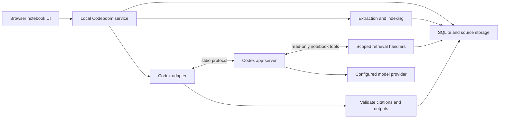

# Codeboom product and technical specification

Status: Product specification v0.1; first prototype implemented, release gates remain subject to [verification](verification.md).  
Date: 2026-10-08

This document owns product requirements and acceptance criteria. The [implementation plan](../plan.md) owns delivery sequence, and the [technical decision record](technical-decisions.md) owns implementation choices and their validation. Technical descriptions below provide the initial design context; maintain changes to those choices in the decision record, and update this spec when requirements change.

Codeboom is a research notebook that uses Codex as its agent harness. Users collect sources around a topic, ask questions grounded in those sources, and save useful answers as reusable research or study materials. Every substantive factual answer should let the user inspect its supporting evidence.

The implemented first prototype is a single-user local web app. This specification remains the release target; implementation evidence and remaining acceptance gates are recorded in [verification.md](verification.md). The technical decision record owns the selected stack and operational choices.

## 1. Product intent and reference behavior

The primary workflow is: collect → understand → investigate → synthesize → reuse.

A representative task: import two architecture proposals and meeting notes, ask where the proposals disagree, inspect the cited passages, then save a comparison brief. The same workflow should support a student turning course readings into a study guide.

The reference products provide two useful behaviors. Google's documentation distinguishes Gemini Notebook's source-only grounding from notebooks in Gemini Apps, which may also use web search and other tools. Codeboom adopts source-only answers for its first release; broader research is a separate later mode. [Google grounding documentation](https://support.google.com/gemininotebook/answer/17003757?hl=en)

Gemini Notebook also combines notebooks with sources, notes, and generated materials including reports, flashcards, quizzes, audio, and slides. Codeboom targets this overall workflow in stages, with inspectable evidence as the common foundation. [Google notebook documentation](https://support.google.com/gemininotebook/answer/16206563?hl=en)

Success means a user can understand and reuse a collection of documents without losing track of where the claims came from. Initial parity is behavioral, with original Codeboom branding and interface design.

## 2. Scope and release sequence

| Capability | First release | Later expansion |
| --- | --- | --- |
| Notebooks | Create, rename, archive, delete; notebook instructions | Tags, templates, cross-notebook discovery |
| Sources | Text PDFs, Markdown, TXT, pasted text, public HTML URLs | DOCX, slide decks, spreadsheets, images and OCR, audio transcripts, YouTube, Drive |
| Source controls | Select sources per conversation, inspect extracted text, refresh URL snapshots | Connector synchronization and discovery |
| Chat | Persistent conversations, source comparisons, citations, follow-up questions, cancellation | Explicit web-assisted research mode |
| Notes | Write notes, save an answer with citations, edit, export Markdown | Rich editing and publishing integrations |
| Studio | Cited summary, briefing document, study guide, FAQ | Flashcards, quizzes, mind maps, data tables |
| Media | No media generation in first release | Audio overview scripts and speech generation, slides, infographics, video |
| Sharing | Export local documents | Accounts, collaboration, permissions, hosted deployment |

Audio overviews are a visible parity gap until the media phase. Codex can orchestrate a later transcript-to-audio workflow, but the design must add and validate a speech-generation capability; the harness alone is not an audio renderer.

First-release exclusions: Google account synchronization, automatic background research, arbitrary code execution requested through the notebook UI, public hosting, billing, mobile apps, and training a new model.

Provisional capacity targets: 50 sources per notebook, 25 MiB per uploaded file, and 500,000 extracted characters per source. These are Codeboom design targets to validate against a representative corpus, not claims about Codex or Google limits. Reject oversized inputs explicitly instead of silently truncating them.

## 3. User experience

The notebook has three primary areas:

| Area | Contents and actions |
| --- | --- |
| Sources | Add files or URLs; inspect import status; select sources; open passages; refresh or remove a source |
| Conversation | Ask questions; see the current source selection; follow progress; stop a run; open citations; save an answer |
| Notes and Studio | Browse saved notes and generated documents; create a new artifact; edit or export it |

On smaller screens, these become tabs. Source selection and run status must remain visible. Citation links must work with keyboard navigation and return focus to the originating claim.

### First useful session

1. Create a notebook and give it a title.
2. Import two or more sources. Each shows queued, processing, ready, needs attention, or failed.
3. Inspect extraction warnings before asking a question. Failed sources are excluded; valid sources remain usable.
4. Ask a question with the selected sources displayed above the composer.
5. Receive a cited answer or an explicit statement that the selected evidence is insufficient.
6. Open a citation at its passage, save the answer as a note, and generate a briefing document.
7. Close and reopen the app; the notebook, conversation, notes, and citations remain available.

An empty notebook prompts for sources. A conversation with zero selected ready sources does not start a model run. With no useful evidence, an answer identifies what is missing and may suggest which document would help.

Notebook instructions can set audience, language, depth, and output style. They cannot override source boundaries or turn imported text into agent instructions.

## 4. Source ingestion and provenance

Every imported source is a snapshot with a stable source ID and immutable revision IDs. Keep the original bytes, a content hash, extraction version, normalized text, and provenance. URL sources also keep the requested URL, final URL, title, and retrieval timestamp.

Import pipeline:

1. Validate format, size, and destination notebook.
2. Copy uploaded bytes or fetch the explicitly supplied public URL.
3. Extract text while preserving PDF page boundaries or document headings and paragraph locations.
4. Record extraction quality and warnings. A scanned PDF with no usable text needs OCR and cannot be marked ready.
5. Split text into bounded, overlapping chunks; preserve offsets into the immutable normalized revision.
6. Index chunks and atomically mark the revision ready.

Source-type selection and per-query selection follow the reference workflow, where sources can be imported and individually selected for chat. Codeboom's supported formats and limits remain those in section 2. [Google source documentation](https://support.google.com/gemininotebook/answer/16215270?hl=en)

Use deterministic extraction for the first release. Do not use a model to silently rewrite source text. Detect duplicate content within a notebook and offer to reuse it; a refresh that changes content creates a new revision. Import retries use an idempotency key and do not create duplicate sources.

For URLs, support ordinary public HTML and direct PDFs. Do not execute page scripts, follow nested links, bypass authentication, or silently treat missing content as successfully imported.

Refresh changes the current revision without rewriting old citations. Removing a source excludes it from future runs but retains its historical revision for existing citations. A separate purge action removes retained source content and marks affected citations unavailable; it must state the consequences for saved outputs. Notebook deletion removes its local sources, indexes, outputs, and managed Codex sessions, subject to the retention boundary in section 10.

## 5. Grounding and citation contract

A run captures an immutable manifest of the selected source revision IDs. All retrieval and citations must resolve against that manifest.

Use SQLite full-text search as the initial retrieval baseline. Codex can reformulate a query and read neighboring passages through tools. For broad summaries, enumerate sections and gather evidence across every selected source rather than treating a few search hits as full coverage. Record omitted sections and label partial coverage. Introduce embeddings or reranking only if retrieval evaluations demonstrate the need.

Each citation records:

- Source ID, immutable revision ID, and chunk or passage ID.
- Exact quoted evidence and character offsets in the normalized revision.
- A display locator, such as PDF page or heading and paragraph.
- The claim or output block it supports.

Numeric labels such as [1] are presentation only. The application resolves them from stored citation records; the model never invents a source URL or file path for the viewer.

Before an answer becomes a completed output, the backend validates that every citation belongs to the run, the passage exists, offsets are valid, and the quote matches stored text. It rejects invalid evidence references. One bounded repair attempt may correct references; otherwise show a failure with the draft available separately and without verified citation styling.

Citation integrity does not prove that a passage supports a claim. Prompting and evaluation must separately check semantic support, correct attribution, and omitted qualifications. The UI must not describe structural citation checks as a truth guarantee.

Answers must distinguish source statements, synthesis or inference, disagreements between sources, and insufficient evidence. Every substantive factual claim needs supporting citations; inferences identify their supporting premises. Imported text is untrusted data even if it looks like a system prompt.

### Selection changes and conversation history

Persist the visible conversation independently of Codex's context. Reuse a Codex thread only while its source manifest, notebook instructions, and grounding mode remain compatible.

When the selected sources, current revisions, or instructions change, begin a fresh Codex context. Keep the old conversation visible, but do not replay previous generated answers or source excerpts into the new context. The next question must be self-contained or the app asks for clarification. This prevents excluded evidence from persisting through conversation history or compaction.

If a source is removed or purged during a run, cancel that run and reject late results. For a refresh or selection change during a run, also cancel and let the user restart with the new manifest. Previously completed outputs retain their historical manifest and display when they use an older revision.

Notes are not evidence by default. A user can explicitly promote a note to a new source revision. Generated notes retain their derivation links and a generated-content label; they cannot count as independent corroboration of their originating documents.

## 6. Codex harness architecture

Codex owns the model/tool loop, thread execution, progress events, and cancellation. Codeboom owns source ingestion, retrieval indexes, product state, citation validation, and saving outputs. The application does not implement a competing general-purpose agent loop.

The proposed integration is a local backend spawning `codex app-server` over stdio. OpenAI documents app-server for custom clients that need authentication, conversation history, approvals, and streamed events; it documents the Codex SDK for programmatic automation as well. App-server and its experimental surfaces need a pinned compatibility test before this design advances beyond a prototype. [Codex app-server](https://learn.chatgpt.com/docs/app-server), [Codex SDK](https://learn.chatgpt.com/docs/codex-sdk)

The browser talks only to the Codeboom service. It never connects to app-server directly or receives provider credentials.

### Integration lifecycle

1. Start the pinned Codex executable in an app-managed environment and complete `initialize` / `initialized`.
2. Read account state and available models. Require user setup when authentication is missing; keep model choice configurable.
3. Start or resume a compatible thread. Persist notebook, conversation, manifest, and Codex thread associations.
4. Call `turn/start` with the question, notebook instructions, source manifest, and structured output schema.
5. Relay progress and collect tool events. Tool handlers derive their authority from the server-held run context.
6. On `turn/completed`, validate output, then commit the answer or artifact atomically.
7. On stop, request `turn/interrupt`; discard late completion after the run is cancelled.

These lifecycle operations and per-turn `outputSchema` are documented app-server capabilities. Generate protocol types from the selected executable rather than hand-maintaining an approximate protocol. [App-server lifecycle and schema](https://learn.chatgpt.com/docs/app-server)

The local CLI observed while drafting is `codex-cli 0.160.0`. This is an observation, not a proven compatibility baseline. Milestone 1 must select and pin the version, generate its schema, and verify the required fields against that version. Do not hardcode a model name based on documentation examples.

### Notebook tools

The proposed prototype uses app-server dynamic tools behind the adapter. Dynamic tool registration and `item/tool/call` are explicitly experimental and require capability opt-in. If this interface is unsuitable, retain the same application contracts behind a scoped MCP server; that alternative needs its own integration check. [Dynamic tool documentation](https://learn.chatgpt.com/docs/app-server#dynamic-tool-calls-experimental)

| Tool | Input | Output |
| --- | --- | --- |
| `notebook_list_sources` | No model-supplied notebook ID | Selected revisions, titles, extraction warnings, section inventory |
| `notebook_search` | Query, bounded result limit | Ranked passages with stable IDs and display locators |
| `notebook_read_passage` | Passage ID, bounded surrounding context | Exact text and immutable revision metadata |
| `notebook_list_sections` | Selected revision ID, cursor | Ordered sections and pagination for comprehensive summaries |

All IDs are checked against the server-held manifest. A model-supplied ID is a lookup request, never permission. The tools are read-only. The backend saves generated outputs after validation; the model does not mutate SQLite or write notebook files directly.

Proposed internal adapter methods are `startSession`, `runTurn`, `cancelTurn`, and `disposeSession`. These are Codeboom abstractions, not names of Codex SDK methods.

### Capability boundary

Reading imported documents must not give the agent access to the user's development repository, home directory, global plugins, or arbitrary network destinations. Launch with dedicated configuration, restricted readable roots, no workspace writes, and no shell or external tools available beyond the approved notebook tools where the runtime permits.

A read-only preset alone is insufficient because it may permit broad reads. Verify effective permissions and loaded instructions; fail startup if the required isolation cannot be enforced on the supported platform. Sandbox settings, tool availability, and the external tool handlers are separate controls. Do not use prompt instructions as the only enforcement mechanism.

The initial support target is the user's macOS local environment. Broader OS support waits for equivalent isolation tests. All model-provider traffic remains necessary for inference; source-only mode disables research browsing and unrelated agent network access.

## 7. Storage and application interfaces

Proposed stack: TypeScript for the local service and Codex adapter, React for the browser UI, and SQLite with full-text search for persistence and retrieval. Choose exact framework and parser versions at implementation time.

Store product data outside tracked source code under a configurable application data directory. Local development may use ignored `.codeboom/`. SQLite owns canonical metadata; immutable blobs hold originals and extracted text. Codex thread history is execution state, not the only copy of the user's notebook.

| Entity | Essential fields |
| --- | --- |
| Notebook | ID, title, instructions and version, timestamps, archive state |
| Source | ID, notebook ID, kind, title, origin, current revision, removal state |
| SourceRevision | ID, source ID, hash, blob path, extraction version, quality, created time |
| Passage | ID, revision ID, section/page locator, text offsets, indexed text |
| Conversation | ID, notebook ID, visible messages, current execution context |
| Run | ID, conversation ID, manifest, instruction version, model/runtime version, status, usage |
| Message | ID, conversation ID, role, blocks, citations, run ID, timestamps |
| Artifact | ID, notebook ID, kind, revisions, content, citations, originating run, edit state |
| Job | ID, type, idempotency key, status, attempt count, error, timestamps |

Enforce notebook ownership through database relationships and every application query, even in the single-user version. Use atomic transactions for final outputs and keep file operations recoverable across crashes.

The local API supports notebook CRUD, source import/refresh/removal, conversations, run start/cancel, artifact generation/edit/export, and citation resolution. Stream progress to the browser using server-sent events with application-assigned sequence numbers and replay from persisted run state. Do not assume Codex notifications are an exactly-once durable event log.

A structured answer has `status` (answered or insufficient_evidence), typed content blocks, citation records, and coverage warnings. Artifact outputs add a kind and structured sections. Persist the output schema version. The UI renders supported blocks safely instead of executing arbitrary returned HTML.

## 8. Notes and generated artifacts

Saving an answer creates an editable note while preserving citations and its source manifest. User edits create a new artifact revision. Mark edited passages as user-authored; do not imply their original citations still support new text without revalidation.

Studio generation shares the same source selection, retrieval, and citation contract as chat:

- Summary: key points and limitations across the selected sources.
- Briefing document: context, findings, disagreements, and open questions.
- Study guide: concepts, explanations, examples, and revision questions.
- FAQ: questions and supported answers.

Generation is explicit and cancellable. A job shows queued, running, validating, completed, failed, or cancelled. Retrying creates a linked attempt and cannot silently overwrite a completed artifact.

Markdown exports include citation footnotes with source title, revision, locator, and available origin URL. If the source is local, say so; do not export a citation link that pretends a local-only source is publicly accessible.

Later flashcards and quizzes include evidence for answers. Later audio overviews first produce a cited script, then synthesize speech through a separately selected provider. Media outputs retain the script and source provenance even when the audio itself cannot display citations.

## 9. Reliability and resource limits

Allow one active run per conversation and bounded local generation admission. The prototype admits at most two active runs and explicitly rejects excess requests for later retry; it does not hold a background backlog. Default prototype budgets: 20 retrieval calls, 120 seconds per chat turn, and 5 minutes per artifact job. Make these configurable and record when a budget is reached; these are product targets pending measurement.

Bound tool response size and total evidence context using the selected model's capacity. A budget cutoff produces a partial-coverage result or explicit failure. Never present a truncated output as a complete notebook analysis.

Record latency, source count, tool calls, runtime/model version, and usage when available. Display unavailable usage as unknown. Do not invent a monetary estimate for subscription-backed execution.

Handle authentication expiry, provider rate limits, parser failure, app-server exit, and malformed output as distinct recoverable errors. A lost connection does not automatically justify rerunning a paid generation. Reconcile stored run/thread state first; if the outcome remains unknown, mark it interrupted and offer retry.

Partial streaming output is provisional until validation completes. Reopening the browser reattaches to the existing local run rather than starting a duplicate.

## 10. Privacy and trust boundaries

Local storage does not mean local inference: the configured model provider receives prompts and selected context. Explain this during setup. Use supported Codex authentication and avoid copying credential files into notebook data or the repository.

Serve the local API on loopback, require a session token, and validate request origins. URL ingestion rejects local, private, link-local, and cloud-metadata destinations, including after DNS resolution and redirects. Apply byte and time limits. Render extracted documents and Markdown without active scripts.

Do not persist raw source text in routine diagnostics. Application data, provider-side data, Codex-managed transcripts, and user exports have different retention boundaries. Purging a source must clear managed local copies and invalidate or delete relevant execution contexts; it cannot erase previous provider requests or exported files. Expose any failed local cleanup instead of claiming complete deletion.

The first release must pass a malicious-document test in which source text attempts to change instructions, read unrelated files, or send data to a URL. The result must preserve evidence boundaries and must not execute those requests.

## 11. Acceptance and evaluation

Create a small fixture corpus with text PDFs, Markdown, a public-page snapshot, contradictory documents, an unsupported scanned PDF, and a document containing prompt injection. Use synthetic or redistributable content.

| Scenario | Required result |
| --- | --- |
| First session | Import two sources, ask a question, inspect citations, save and reopen a note |
| Citation integrity | 100% of completed output references resolve to selected immutable revisions with exact quote matches |
| Insufficient evidence | At least 9 of 10 deliberately unanswerable fixture questions correctly abstain |
| Claim support | At least 95% of factual claims in a fixed 30-question fixture set are supported by cited passages on human review |
| Source conflict | Present both conflicting statements with their respective evidence |
| Isolation | Cross-notebook IDs and excluded revisions are rejected; unrelated files and network endpoints remain inaccessible |
| Selection change | Start a fresh context; no excluded source text appears in retrieval or replayed model context |
| Refresh and removal | Old completed citations retain their version; active affected runs cancel; purged evidence shows unavailable |
| Broad summary | Cover every selected source or visibly identify omitted sources/sections |
| Failure and retry | Recover from parser/runtime failure without duplicate sources, runs, or artifacts |
| Cancellation | UI acknowledges stop immediately and no later output is committed from that run |
| Export | Exported artifact includes usable human-readable provenance |
| Persistence | Restart the service and recover notebooks, notes, history, and citation locations |

These are release gates; consult [verification.md](verification.md) for achieved metrics and open checks. Structural validation is deterministic; semantic support needs separately labeled human review. Keep the evaluation corpus and rubric versioned so model or harness upgrades can be compared.

Measure ingestion time, time to first progress, end-to-end answer latency, and cancellation completion during the first prototype. Set performance commitments after a baseline exists; network model latency is not under complete application control.

## 12. Implementation milestones

1. **Harness integration proof.** Pin Codex, generate protocol types, verify authentication and model discovery, enforce isolation, register read tools, stream and cancel a turn, and obtain schema-valid output. Answer one question over two text fixtures with working citations. Exit gate: the adapter and tool boundaries work on the target machine.
2. **Notebook and ingestion foundation.** Implement SQLite migrations, source revisions, text/PDF/URL extraction, full-text search, source viewer, and import errors. Exit gate: deterministic provenance survives a restart.
3. **Grounded conversation.** Connect the three-area UI, source selection, thread mapping, validation, streaming, and insufficient-evidence behavior. Exit gate: citation, conflict, isolation, and selection-change tests pass.
4. **Reusable outputs.** Add notes, the four initial Studio formats, revisions, and Markdown export. Exit gate: an end-to-end research session can be completed and exported.
5. **First-release hardening.** Add recovery, budgets, deletion, accessibility checks, and the evaluation corpus. Exit gate: all first-release acceptance criteria pass.
6. **Expanded parity.** Prioritize flashcards/quizzes, mind maps, richer imports, audio, research mode, and sharing based on actual use. Hosted deployment requires a new identity, tenancy, authentication, and runtime-support design.

Each milestone should produce a working slice. The first build task is milestone 1; a large UI scaffold should not precede proof that Codex can satisfy the notebook tool and isolation contracts.

## 13. Decisions to revisit

| Decision | Proposed default | Reason to revisit |
| --- | --- | --- |
| Product surface | Local browser app | User may prefer a workflow entirely inside Codex or a hosted product |
| Agent interface | App-server over stdio with adapter | Experimental interface stability or isolation limitations |
| First user | Individual researcher or student | Team workflows add sharing and governance requirements |
| Retrieval | SQLite full-text search with iterative reads | Missed semantic matches or larger collections |
| Source grounding | Selected sources only | Later explicit web-assisted research mode |
| Model and auth | User-supported Codex auth and available model | Account access, quality, latency, and cost |
| Media priority | Text outputs first; audio later | Audio may be the user's primary parity requirement |

OpenAI and Google capabilities cited here were checked on 2026-10-08. Recheck the integration documentation when pinning dependencies; product requirements and proposed contracts remain owned by Codeboom.
